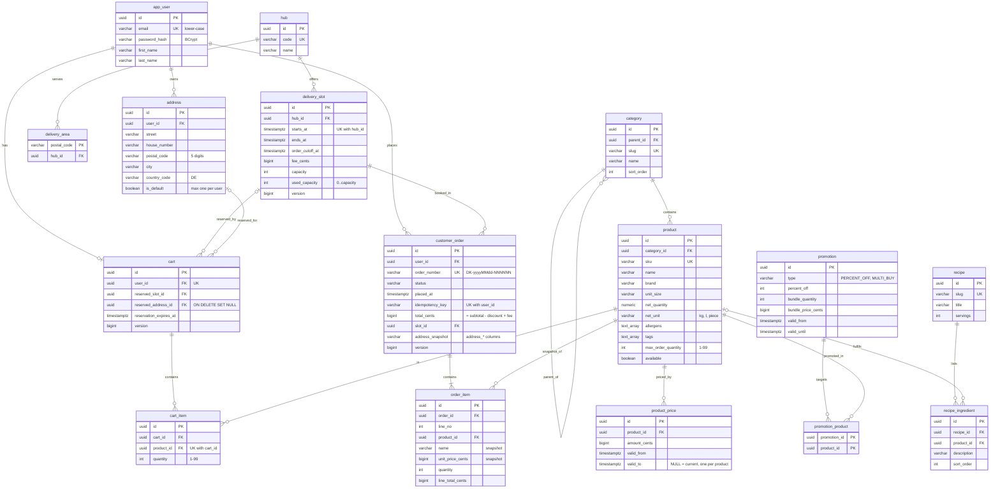

# Database design

The database is PostgreSQL 18.6. Flyway owns the schema:
`services/backend/src/main/resources/db/migration/V1__schema.sql` holds the
schema, and `V2__seed_data.sql` holds the invented seed data. All primary keys
are UUIDs. Unless noted, every table has `created_at` and `updated_at`. Money
columns hold `*_cents bigint` plus a `currency`.

## Entity relationship diagram

## Changes to the candidate entities

| Candidate | Result |
|---|---|
| User | `app_user`, because `user` is a reserved word in PostgreSQL |
| Address | `address`. Serviceability is derived through `delivery_area`, not stored |
| Product, Category | As proposed. The category tree uses `parent_id` |
| ProductPrice | `product_price` keeps price history. A partial unique index allows one open-ended row per product |
| Promotion | `promotion` plus a `promotion_product` join table. A CHECK constraint enforces the type-specific columns |
| ShoppingCart / CartItem | `cart` (one per user) and `cart_item`. The slot reservation is stored as columns on `cart` instead of a separate table |
| DeliverySlot | `delivery_slot`. Its capacity counter is guarded by `SELECT … FOR UPDATE` |
| Order / OrderItem | `customer_order` (`order` is a reserved word) and `order_item`. Prices, address and slot times are **snapshots** taken when the order is placed |
| Recipe | `recipe` and `recipe_ingredient`. There is no API yet (backlog B-18) |
| *New:* Hub, DeliveryArea | Needed to map postal codes to slot capacity |

## Integrity rules enforced in the database
- E-mail is stored lower-case and unique.
- Each user has at most one default address (partial unique index).
- Each product has exactly one current price (partial unique index).
- Each user's `idempotency_key` is unique (partial unique index), so a checkout retry cannot create a second order.
- `customer_order.total_cents = subtotal - discount + fee` (CHECK).
- `0 ≤ used_capacity ≤ capacity` (CHECK). This is the last line of defence against overselling a slot.

The seed data holds 9 categories, 42 products, 6 promotions (one of them expired), 3 hubs and 10 postal codes. All of it is invented.
