# Database design

The database is PostgreSQL 18.6 with the `pg_trgm` extension (no PostGIS). Flyway owns the schema in
`services/backend/src/main/resources/db/migration`:

| Migration | Content |
|---|---|
| `V1__schema.sql` | Schema |
| `V2__reference_data.sql` | Locales (de, en, ar), UI texts, market types, cuisines, categories, Hamburg gazetteer |
| `V3__seed_hamburg.sql` | Invented demo data: 12 markets, 158 shared catalog products, 529 listings, banners, promotions |

Demo user accounts are **not** part of the migrations; the backend creates them in the `local`/`demo` profiles.

All primary keys are UUIDs, except code tables (`supported_locale`, `market_type`, `cuisine`). Money is stored as
`*_cents bigint` with a `currency` (EUR). Coordinates are WGS84 `double precision`. Timestamps are `timestamptz`.
Translatable content lives in `*_translation` tables keyed by `locale`; adding a language only needs rows.

## Entity relationship diagram

```mermaid
erDiagram
  supported_locale ||--o{ ui_text : translates
  app_user ||--o{ app_user_role : has
  app_user ||--o{ address : owns
  app_user ||--o{ market_owner : owns
  market ||--o{ market_owner : owned_by
  market_type ||--o{ market : classifies
  market_type ||--o{ market_type_translation : named
  cuisine ||--o{ cuisine_translation : named
  cuisine ||--o{ market_cuisine : tags
  market ||--o{ market_cuisine : has
  market ||--o{ market_translation : described
  market ||--o{ market_opening_hours : opens
  market ||--o{ banner : shows
  banner ||--o{ banner_translation : texts
  category ||--o{ category : parent_of
  category ||--o{ category_translation : named
  category ||--o{ catalog_product : contains
  market |o--o{ catalog_product : owns_private
  catalog_product ||--o{ catalog_product_translation : named
  catalog_product ||--o{ catalog_product_cuisine : origin
  cuisine ||--o{ catalog_product_cuisine : tags
  market ||--o{ market_product : lists
  catalog_product ||--o{ market_product : listed_as
  market_product ||--o{ market_product_price : priced
  market ||--o{ promotion : runs
  promotion ||--o{ promotion_translation : titled
  promotion ||--o{ promotion_product : targets
  market_product ||--o{ promotion_product : promoted
  app_user ||--o{ favorite_market : likes
  market ||--o{ favorite_market : liked
  app_user ||--o{ favorite_product : likes
  market_product ||--o{ favorite_product : liked
  market ||--o{ fulfilment_slot : offers
  app_user ||--o{ cart : has
  market ||--o{ cart : for
  fulfilment_slot |o--o{ cart : reserved_by
  address |o--o{ cart : reserved_for
  cart ||--o{ cart_item : contains
  market_product ||--o{ cart_item : in
  app_user ||--o{ customer_order : places
  market ||--o{ customer_order : receives
  fulfilment_slot ||--o{ customer_order : booked_in
  customer_order ||--|{ order_item : contains

  supported_locale {
    varchar code PK
    varchar native_name
    varchar direction
    boolean enabled
    int sort_order
  }
  ui_text {
    varchar key PK
    varchar locale PK
    varchar text
  }
  app_user {
    uuid id PK
    varchar email UK
    varchar password_hash
    varchar first_name
    varchar last_name
    varchar preferred_locale FK
  }
  app_user_role {
    uuid user_id PK
    varchar role PK
  }
  gazetteer_place {
    uuid id PK
    varchar kind
    varchar street
    varchar postal_code
    varchar district
    varchar city
    double lat
    double lng
  }
  market_type {
    varchar code PK
    varchar icon_key
    int sort_order
  }
  market_type_translation {
    varchar market_type_code PK
    varchar locale PK
    varchar name
  }
  cuisine {
    varchar code PK
    varchar icon_key
    int sort_order
  }
  cuisine_translation {
    varchar cuisine_code PK
    varchar locale PK
    varchar name
  }
  market {
    uuid id PK
    varchar slug UK
    varchar name
    varchar type_code FK
    varchar status
    varchar primary_locale FK
    varchar address_line
    double lat
    double lng
    text_array tags
    boolean delivery
    boolean pickup
    double delivery_radius_km
    bigint delivery_fee_cents
    bigint free_delivery_from_cents
    bigint minimum_order_cents
    varchar legal_name
    varchar register_info
  }
  market_translation {
    uuid market_id PK
    varchar locale PK
    varchar description
  }
  market_cuisine {
    uuid market_id PK
    varchar cuisine_code PK
  }
  market_opening_hours {
    uuid market_id PK
    smallint day_of_week PK
    time opens_at PK
    time closes_at
  }
  market_owner {
    uuid market_id PK
    uuid user_id PK
  }
  banner {
    uuid id PK
    uuid market_id FK
    varchar tint
    varchar image_url
    varchar target_type
    uuid target_id
    int sort_order
    boolean active
  }
  banner_translation {
    uuid banner_id PK
    varchar locale PK
    varchar overline
    varchar title
  }
  category {
    uuid id PK
    uuid parent_id FK
    varchar slug UK
    varchar icon_key
    int sort_order
  }
  category_translation {
    uuid category_id PK
    varchar locale PK
    varchar name
  }
  catalog_product {
    uuid id PK
    uuid owner_market_id FK
    uuid category_id FK
    varchar brand
    varchar unit_size
    numeric net_quantity
    varchar net_unit
    boolean organic
    text_array allergens
    text_array keywords
    varchar barcode
    varchar image_url
    varchar origin
    text search_text
  }
  catalog_product_translation {
    uuid catalog_product_id PK
    varchar locale PK
    varchar name
    varchar description
    varchar tagline
    varchar ingredients
    varchar search_name
  }
  catalog_product_cuisine {
    uuid catalog_product_id PK
    varchar cuisine_code PK
  }
  market_product {
    uuid id PK
    uuid market_id FK
    uuid catalog_product_id FK
    bigint price_cents
    boolean available
    int max_order_quantity
    timestamptz created_at
    timestamptz deleted_at
  }
  market_product_price {
    uuid id PK
    uuid market_product_id FK
    bigint amount_cents
    timestamptz valid_from
    timestamptz valid_to
  }
  promotion {
    uuid id PK
    uuid market_id FK
    varchar type
    int percent_off
    int bundle_quantity
    bigint bundle_price_cents
    timestamptz valid_from
    timestamptz valid_until
    timestamptz created_at
  }
  promotion_translation {
    uuid promotion_id PK
    varchar locale PK
    varchar title
    varchar description
  }
  promotion_product {
    uuid promotion_id PK
    uuid market_product_id PK
  }
  favorite_market {
    uuid user_id PK
    uuid market_id PK
  }
  favorite_product {
    uuid user_id PK
    uuid market_product_id PK
  }
  address {
    uuid id PK
    uuid user_id FK
    varchar street
    varchar house_number
    varchar postal_code
    varchar city
    varchar country_code
    double lat
    double lng
    boolean is_default
  }
  fulfilment_slot {
    uuid id PK
    uuid market_id FK
    varchar type
    timestamptz starts_at
    timestamptz ends_at
    timestamptz order_cutoff_at
    int capacity
    int used_capacity
    bigint version
  }
  cart {
    uuid id PK
    uuid user_id FK
    uuid market_id FK
    varchar fulfilment_type
    uuid reserved_slot_id FK
    uuid reserved_address_id FK
    timestamptz reservation_expires_at
    bigint version
  }
  cart_item {
    uuid id PK
    uuid cart_id FK
    uuid market_product_id FK
    int quantity
  }
  customer_order {
    uuid id PK
    uuid user_id FK
    uuid market_id FK
    varchar order_number UK
    varchar status
    varchar fulfilment_type
    timestamptz placed_at
    varchar idempotency_key
    varchar market_name
    varchar customer_name
    bigint subtotal_cents
    bigint discount_total_cents
    bigint delivery_fee_cents
    bigint total_cents
    uuid slot_id FK
    timestamptz slot_order_cutoff_at
    varchar address_street
    bigint version
  }
  order_item {
    uuid id PK
    uuid order_id FK
    int line_no
    uuid market_product_id
    uuid catalog_product_id
    varchar name
    bigint unit_price_cents
    int quantity
    bigint line_total_cents
  }
```

The diagram shows the key columns; `created_at`/`updated_at` and some snapshot columns are omitted. Every
`locale` column is a foreign key to `supported_locale`.

## Tables

| Area | Table | Notes |
|---|---|---|
| i18n | `supported_locale` | Enabled content locales (`de` fallback, `en`, `ar` with `direction = rtl`) |
| i18n | `ui_text` | Short server texts: home section titles, badge templates (`{percent} % Rabatt`) |
| identity | `app_user`, `app_user_role` | `app_user` because `user` is reserved. E-mail lower-case and unique. Roles CUSTOMER, MERCHANT, ADMIN |
| geo | `gazetteer_place` | Built-in Hamburg gazetteer behind `GeocodingService`: districts (centroids), postal codes, streets of the seed data. Index on (lat, lng) |
| market | `market` | Status PENDING_REVIEW / ACTIVE / SUSPENDED. Delivery needs radius and fee (CHECK). Index on (lat, lng) for the bounding-box prefilter of the Haversine radius search |
| market | `market_type`, `cuisine` (+ `_translation`), `market_cuisine` | Filter-chip code lists |
| market | `market_translation` | Localised description |
| market | `market_opening_hours` | Several intervals per day, Europe/Berlin local time, `closes_at > opens_at` |
| market | `market_owner` | Merchant ownership; everything under `/merchant/**` is checked against it |
| market | `banner`, `banner_translation` | Start-page banners with a tint instead of an image; target CATEGORY / PROMOTIONS / NEW / PRODUCT |
| catalog | `category`, `category_translation` | Category tree via `parent_id` |
| catalog | `catalog_product` (+ `_translation`, `_cuisine`) | Shared master catalog ("model B"). `owner_market_id` is NULL for shared products and set for market-private ones. `search_text` holds the normalised names of all translations + brand + keywords and has a `gin_trgm_ops` index; `search_name` is the normalised name per locale (ranking) |
| catalog | `market_product` | A market's listing; its id is the API's product id. Unique `(market_id, catalog_product_id)` among non-deleted rows (partial index); soft delete via `deleted_at`; `created_at` drives "new" |
| catalog | `market_product_price` | Price history; one open row (`valid_to IS NULL`) per listing equals `market_product.price_cents` |
| promotion | `promotion`, `promotion_translation`, `promotion_product` | Per market; CHECK enforces the type-specific columns; the newest active promotion per listing wins |
| favorite | `favorite_market`, `favorite_product` | "Frequently ordered" is derived from `order_item`, not stored |
| address | `address` | Coordinates from the client or the gazetteer, NULL if unknown. At most one default per user |
| fulfilment | `fulfilment_slot` | Generated on demand per market and type, unique `(market_id, type, starts_at)`; capacity guarded by `SELECT … FOR UPDATE` |
| cart | `cart`, `cart_item` | One cart per user **and market** (unique). The reservation (type, slot, address, expiry) lives on the cart; optimistic `version` |
| order | `customer_order`, `order_item` | `order` is reserved. Snapshots of market name, customer name, prices, slot times and delivery address (NULL for pickup) |

## Integrity rules enforced in the database

- E-mail is stored lower-case and unique; roles and locales are constrained to known values.
- Each user has at most one default address (partial unique index); address coordinates are both set or both NULL.
- A market offers delivery, pickup or both; delivery requires `delivery_radius_km` 0.5–50 and a fee.
- A market lists a catalog product at most once among non-deleted listings (partial unique index).
- Each listing has exactly one current price row (partial unique index).
- One cart per user and market; a cart's reservation columns are all set or all NULL.
- Each user's `idempotency_key` is unique, so a checkout retry cannot create a second order.
- `customer_order.total_cents = subtotal - discount + fee`; delivery orders carry an address snapshot.
- `0 ≤ used_capacity ≤ capacity` on `fulfilment_slot`, the last line of defence against overselling.

All seed data (markets, streets, brands, products, prices) is invented test data.
