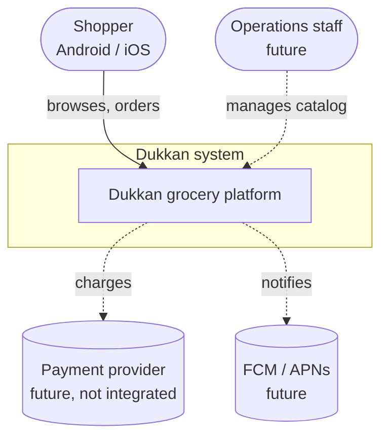
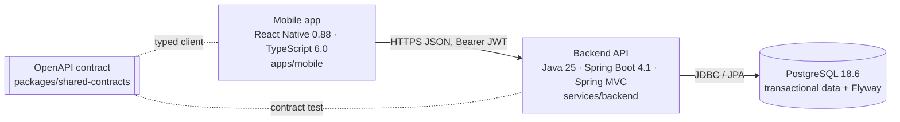
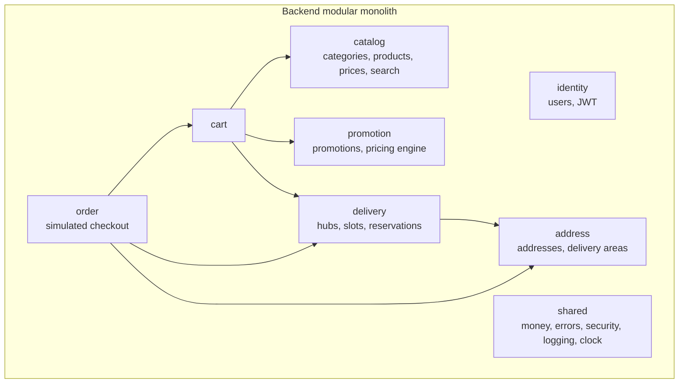

# Architecture overview

Dukkan is an independent grocery-delivery MVP. It has a React Native app, a
Spring Boot modular monolith and a PostgreSQL database. The API contract is
defined in a shared OpenAPI file.

## C4 Level 1: system context

## C4 Level 2: containers

## C4 Level 3: backend modules

Each module exposes `api` (REST), `application` (service interfaces) and
`domain` packages, and keeps its JPA repositories in `infrastructure`.
Modules call each other only through application interfaces. An ArchUnit test
in the backend enforces this.

## Cross-cutting concerns

| Concern | Approach |
|---|---|
| Errors | RFC 9457 `ProblemDetail` with a stable `code` from one `@RestControllerAdvice` |
| Validation | Bean Validation on request records; contract regexes mirrored |
| AuthN/Z | Stateless JWT (HS256, self-issued) via Spring Security's resource server; BCrypt passwords; ownership checks in every user-scoped query |
| Logging | Spring Boot structured logging (JSON) outside `local`; `X-Request-Id` correlation in MDC |
| Config | `@ConfigurationProperties` records under `dukkan.*`; secrets only through environment variables |
| Time | An injected `Clock` (slots, cutoffs and promotions are testable) |
| Money | `long` cents plus an ISO currency; all computation on the server |
| Concurrency | Pessimistic row lock on `delivery_slot` when reserving; optimistic `version` on the cart |
| API docs | springdoc at `/v3/api-docs` and `/swagger-ui.html`, checked against the shared contract by a test |

## Technology use, and what we left out

| Technology (requested) | Used in MVP? | Justification |
|---|---|---|
| PostgreSQL 18.6 | Yes | Primary transactional store (ADR 0001) |
| Spring Boot 4.1.1, Java 25, Gradle 9.8.1 | Yes | Core backend |
| Error Prone 2.50.0 + Error Prone Support 0.30.0 | Yes | Static analysis at compile time |
| React Native 0.88.0, React 19.3.1, TS 6.0.3, typescript-eslint 8.71.2 | Yes | Mobile |
| Docker / Compose | Yes | Local Postgres and backend image |
| Kubernetes 1.36.5 | Manifests only | Minimal deployable shape for staging; not needed locally |
| Project Reactor | Managed by the Boot BOM, not used directly | No streaming or backpressure use case yet (ADR 0002) |
| MongoDB 8.2 / driver 5.8.1 | No | No document-shaped or schemaless data yet. Candidate: recipe content or server-driven page documents (ADR 0002) |
| RabbitMQ 4.3.6 / Spring AMQP 4.1.1 | No | No async consumers yet. Candidate: order events for fulfilment and notifications (ADR 0002) |
| Python 3.14.8, pandas, scikit-learn, Snowflake connector | No | No data or ML use case in the MVP. Candidate: demand forecasting for slot capacity (backlog) |
| Kotlin 2.3.21 | No | Optional. One JVM language keeps the MVP simple |

Decisions: see [decisions/](decisions/).
