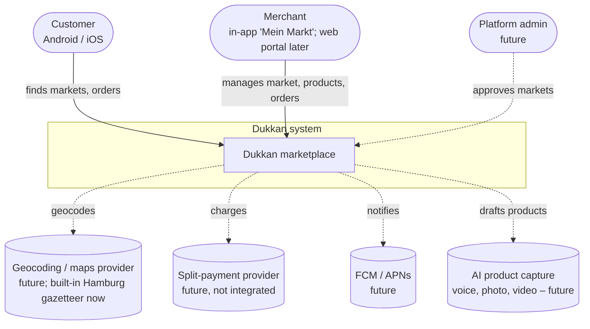
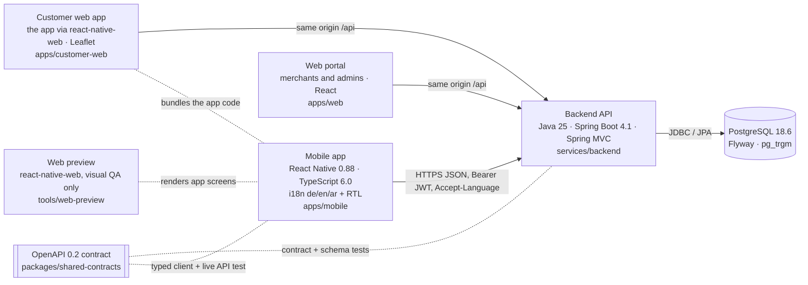
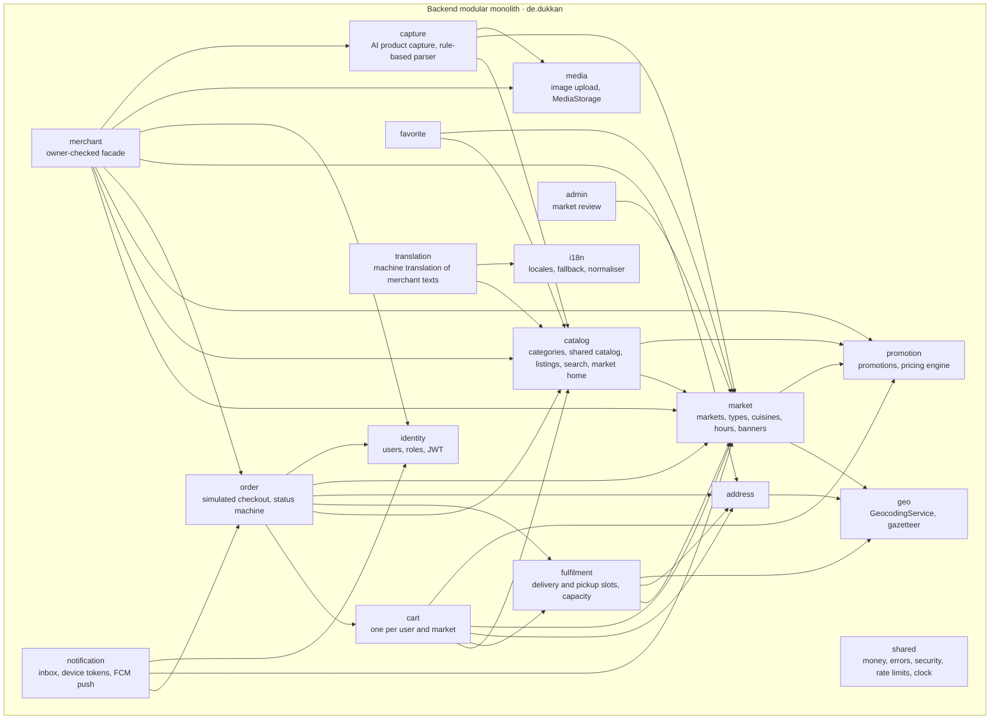
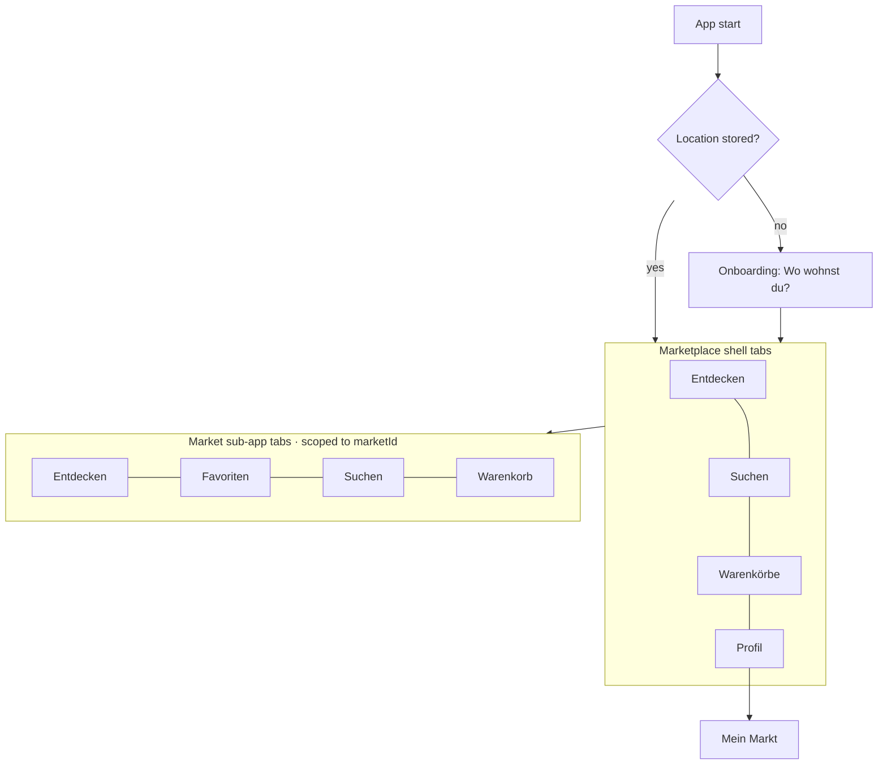

# Architecture overview

Dukkan is a marketplace for local markets in Hamburg: supermarkets, ethnic
groceries, bakeries, butchers and similar shops. It consists of a React Native
app, a Spring Boot modular monolith and PostgreSQL. The API contract is a
shared OpenAPI file. Product decisions: [`docs/product/marketplace.md`](../product/marketplace.md).
Design: [`docs/design/design-system.md`](../design/design-system.md).

## C4 Level 1: system context

## C4 Level 2: containers

## C4 Level 3: backend modules

`capture` calls the Claude API (optional, `ProductDraftExtractor` port, ADR 0011); without a key it
runs only its rule-based parser. Both paths run outside a database transaction.

`order` writes `order.placed` / `order.status_changed` into a transactional outbox
(`shared.events`); `notification` consumes them in-process or through RabbitMQ (ADR 0012).

Edges show module dependencies derived from the imports. Every module also uses `i18n` and `shared`.
Modules call each other only through `application` interfaces. Where a
dependency would create a cycle, the depending module defines a port:
`catalog.application.ListingFavorites` is implemented by `favorite`, and
`PurchaseHistory` by `order`. ArchUnit tests enforce both rules.

## Mobile app structure

## Cross-cutting concerns

| Concern | Approach |
|---|---|
| Languages | App strings in i18next JSON (de/en/ar). Content in `*_translation` tables. `Accept-Language` → `Content-Language`. A new language is data plus one JSON file (ADR 0008) |
| RTL | Root `direction` switch plus start/end styles. Numbers and money stay `de-DE` |
| Search | A normalised `search_text` over all translations and keywords (German and Arabic folding), pg_trgm. Tiered relevance |
| Geo | Haversine radius queries. Pluggable `GeocodingService` |
| Tenancy | Everything sold belongs to one market. `market_owner` ownership checks; foreign markets return 404 (ADR 0009) |
| Errors | RFC 9457 `ProblemDetail` with a stable `code` (and per-field `code`). Clients translate |
| AuthN/Z | Stateless JWT (HS256) with a `roles` claim. Feature flags `require-login-to-browse` and `merchant-auto-approve` |
| Concurrency | `SELECT … FOR UPDATE` on slots; optimistic `version` on carts and orders |
| Logging | ECS JSON outside `local`; `X-Request-Id` in the MDC |
| Testing | Contract mapping, response-schema checks (required fields and no undocumented ones), ArchUnit, Testcontainers flows, mobile unit and component tests, a live API test of the app client against the real backend (CI job `e2e-api`) |

## Technology use, and what we left out

| Technology (requested) | Used? | Justification |
|---|---|---|
| PostgreSQL 18.6 | Yes | Transactional store with pg_trgm for multilingual search. PostGIS is deferred (ADR 0009) |
| Spring Boot 4.1.1, Java 25, Gradle 9.8.1, Error Prone 2.50.0 + Support 0.30.0 | Yes | Backend |
| React Native 0.88.0, React 19.3.1, TS 6.0.3, typescript-eslint 8.71.2 | Yes | Mobile |
| Docker / Compose, Kubernetes 1.36.5 manifests | Yes / manifests only | Local stack and a minimal deploy shape |
| Project Reactor, MongoDB, RabbitMQ, Python ML stack, Kotlin | Not yet | ADR 0002. Triggers: order events to merchants and notifications (RabbitMQ), live tracking (Reactor/SSE), editorial or AI-generated product content (MongoDB), demand forecasting (Python) |

Decisions: see [decisions/](decisions/).
