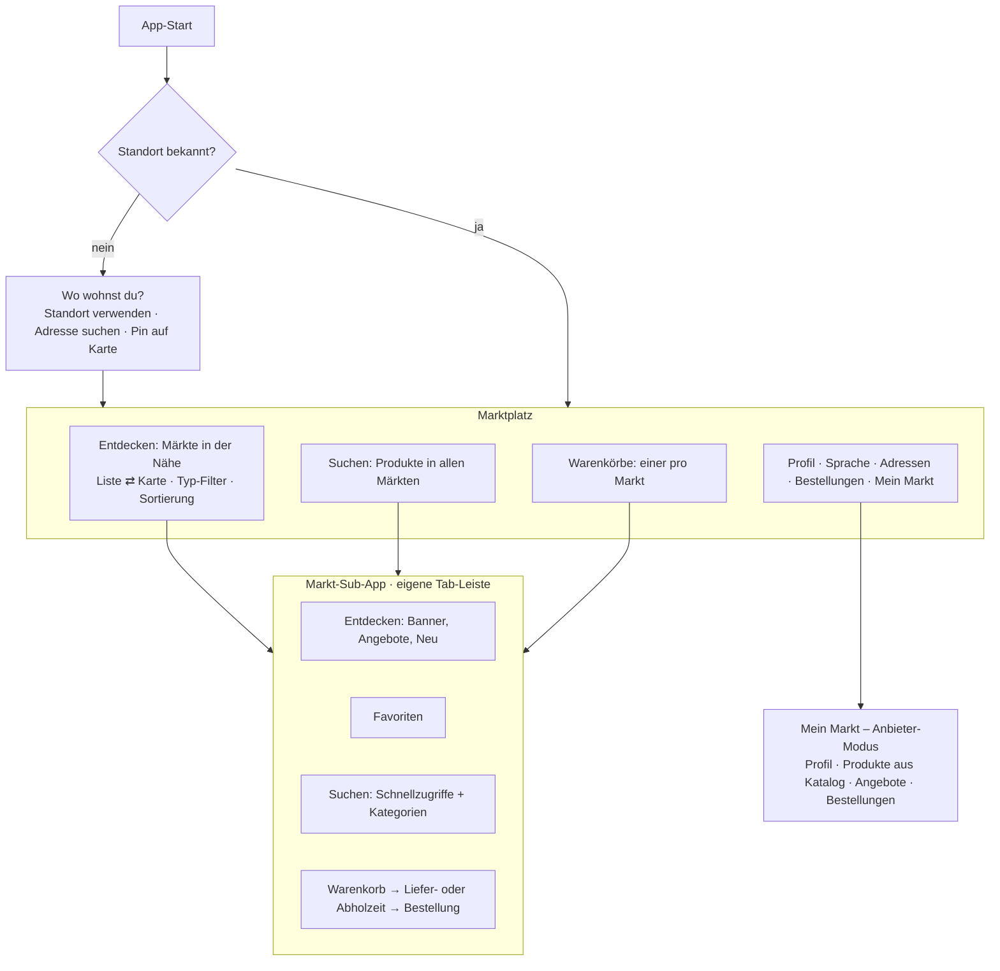

# Dukkan – Marktplatz für Märkte in der Nähe

Stand: 2026-10-20. Hier steht, was wir zusammen festgelegt haben (**F**) und was
ich selbst als Standard gewählt habe (**S**). Ein **S** kannst du jederzeit ändern.

## 1. Produktidee

Kundinnen und Kunden geben ihren Standort an und sehen Märkte in der Nähe als
Liste oder auf der Karte. Sie können nach Markttyp filtern und nach Entfernung
und anderem sortieren. Öffnet man einen Markt, startet darin eine
**„Sub-App“** im Design der Referenz-Screenshots: eigene Startseite, Favoriten,
Suche mit Kategorien und Warenkorb, alles nur für diesen Markt. Marktanbieter
pflegen ihren Markt selbst: Profil, Produkte, Angebote und Zeitfenster.

## 2. Entscheidungen

| # | Thema | Entscheidung | |
|---|---|---|---|
| 1 | Sprachen | Deutsch, Englisch, Arabisch. Weitere Sprachen kommen ohne Umbau dazu | F |
| 2 | Standardsprache | Sprache des Geräts. Wird sie nicht unterstützt, gilt **Deutsch**. Ein Sprach-Knopf oben rechts erlaubt jederzeit den Wechsel | F / S (Rückfall) |
| 3 | Arabisch | Die App wird gespiegelt (RTL). Zahlen und Preise bleiben in westlichen Ziffern im deutschen Format (`2,49 €`) | F |
| 4 | Suche | Man findet ein Produkt in jeder Sprache. Gesucht wird über alle Übersetzungen und mehrsprachige Schlagwörter | F |
| 5 | Markttypen | Supermarkt, Lebensmittelladen, Bäckerei, Metzgerei, Obst & Gemüse, Feinkost, Hofladen, Wochenmarkt, Getränke. Dazu Herkunftsküchen (türkisch, arabisch, indisch, asiatisch, polnisch, afrikanisch, …). Auf der Startseite gibt es Filter-Chips für beides | F / S (Liste) |
| 6 | Lieferung / Abholung | Jeder Markt bietet Lieferung, Abholung oder beides an. Wer ausliefert, ist offen; in Phase 1 wird es simuliert | F |
| 7 | Warenkorb | Ein Warenkorb pro Markt, nichts wird vermischt. Jeder Markt ist eine Sub-App | F |
| 8 | Suche über alle Märkte | Ja, von außen über alle Märkte in der Nähe (mit Preisvergleich) und innen pro Markt | F |
| 9 | Produktdaten | **Gemeinsamer Produktkatalog** (Modell B) mit Übersetzungen, Bildern, Allergenen und Herkunftsküche, also z. B. eine „türkische Produktdatenbank“. Der Markt übernimmt Produkte daraus und setzt Preis und Verfügbarkeit. Fehlt ein Produkt, legt er es selbst an | F |
| 10 | KI-Erfassung | Produkte per Sprache, Foto, Video oder Text anlegen. **Später.** Die Architektur sieht dafür eine Schnittstelle vor (siehe §4) | F (später) |
| 11 | Bezahlung | Simuliert. Die App ist nicht in Produktion | F |
| 12 | Geschäftsmodell | Offen. Zunächst kostenlos für alle | F |
| 13 | Startregion | Deutschland, **Hamburg**. Die Testmärkte liegen in Hamburger Stadtteilen | F |
| 14 | Login | Phase 1: stöbern ohne Konto, Login erst für Warenkorb, Favoriten und Bestellung. Später soll ein Konto Pflicht sein; das wird ein **Schalter**, kein Umbau | F |
| 15 | Karten / Adresssuche | Anbieter noch offen. Die Adresssuche läuft hinter einer **austauschbaren Schnittstelle**; Phase 1 nutzt ein eingebautes Hamburg-Verzeichnis. Karte: Apple Maps (iOS) und Google Maps (Android, braucht später einen API-Key) | F (offen) / S |
| 16 | Hosting | Offen. Die Container laufen auf jeder Cloud | F (offen) |
| 17 | Marke | Name „Dukkan“, noch kein Logo. Gleiche Stimmung wie die Screenshots: Weiß, frisches Grün, rotes Akzent, Fotos auf zarten Flächen. Eigene Farbtöne, keine fremden Marken, Fotos oder Maskottchen | F |
| 18 | Arabische Anrede | Neutral bzw. Plural | S |
| 19 | Schrift | **Inter** (die verbreitetste freie UI-Schrift, nah am Referenzlook) für Latein, **IBM Plex Sans Arabic** für Arabisch. Beide sind Open Source (OFL) | F / S |
| 20 | Dunkelmodus | Ja, über Design-Tokens ab Tag 1 | F |
| 21 | Gestaltung pro Markt | Nur Logo, Titelfoto und Banner. Alle Märkte bleiben im einheitlichen Dukkan-Design. Später ist ein KI-generiertes Bild der Ladenfront denkbar | F |
| 22 | Marktkarte | Titelfoto, Logo, Name, Typ und Küche, Entfernung, geöffnet/geschlossen, Lieferung und/oder Abholung, Mindestbestellwert, Liefergebühr, Anzahl der Angebote | S |
| 23 | App-Start | Standort zuerst. Die Sprache folgt dem Gerät; der Sprach-Knopf ist sichtbar | S |
| 24 | Testbilder | Einheitliche Platzhalter, bis echte Fotos da sind | S |
| 25 | Weggelassen | Rezepte/Kochen, Sparpunkte, „Family“, Gratis-Geschenke, Ladenkonzept „Markthalle“ | S |

## 3. Aufbau der App

Für die Demo in Phase 1 ist der Anbieter-Modus in derselben App (Konto mit
Rolle „Anbieter“). Später bekommt er ein eigenes Web-Portal.

## 4. Architektur-Leitplanken

- **Mehrsprachigkeit:**
  - App-Texte liegen in Sprachdateien (`i18next`); eine neue Sprache ist eine neue Datei.
  - Das Layout arbeitet mit „Anfang/Ende“ statt „links/rechts“ und unterstützt RTL.
  - Das Backend speichert Inhalte pro Sprache in Übersetzungstabellen, mit dem Rückfall angefragte Sprache → Hauptsprache des Markts → Deutsch. Fehler liefert es als Codes, die die App übersetzt. Freigeschaltete Sprachen stehen in der Tabelle `supported_locale`.
- **Mandanten:** Alles Verkaufsbezogene gehört zu genau einem Markt: Angebote, Preise, Zeitfenster, Warenkörbe und Bestellungen. Anbieter sehen nur ihren eigenen Markt.
- **Katalog:** `catalog_product` ist der gemeinsame Stammartikel mit Übersetzungen, Herkunftsküche und Schlagwörtern. `market_product` ist das Angebot eines Markts mit Preis und Verfügbarkeit.
- **Geodaten:** Umkreissuche über Koordinaten in PostgreSQL. PostGIS kommt erst, wenn es Liefergebiete als Polygone gibt.
- **Austauschbare Dienste:** Adresssuche, Bildspeicher, KI-Produkterfassung und Bezahlung laufen hinter Interfaces. Phase 1 nutzt einfache lokale Implementierungen.
- **Feature-Schalter:** z. B. `requireLoginToBrowse`, `merchantAutoApprove`.

## 5. Phasen

| Phase | Umfang |
|---|---|
| **1 (jetzt)** | Standort-Start, Märkte in der Nähe (Liste, Karte, Filter, Sortierung), Markt-Sub-App im Referenzdesign, Suche über alle Märkte, Warenkorb pro Markt, Lieferung oder Abholung mit simulierter Bestellung, Favoriten, DE/EN/AR mit RTL und Dunkelmodus, Anbieter-Modus (Markt anlegen, Produkte aus dem Katalog oder neu, Angebote, Bestellstatus) |
| 2 | Web-Portal für Anbieter, Bild-Upload, KI-Erfassung (Sprache, Foto, Video), echter Karten- und Adressdienst, Push-Benachrichtigungen |
| 3 | Echte Zahlung (Split-Payment), Lieferung oder Fahrer-Logistik, Bewertungen, Geschäftsmodell, Pflicht-Login |
