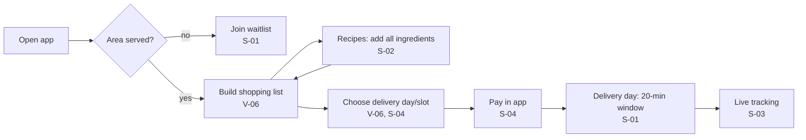
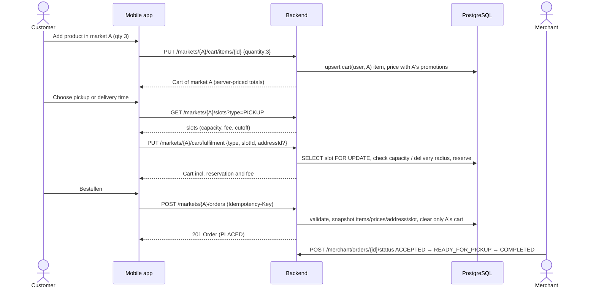
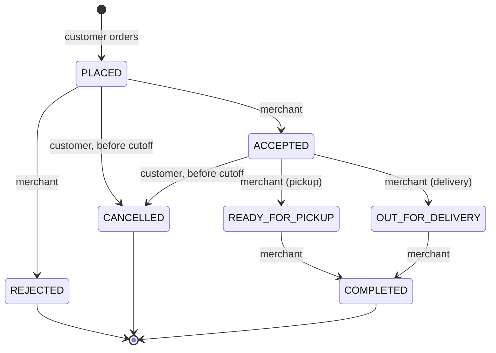

# User flows

The first diagram is our reading of the **reported** high-level Picnic flow
(V-06, S-01, S-04). The rest describe the **Dukkan** marketplace design. They
are kept separate on purpose.

## Reported flow (Picnic, high level, not verified on an artifact)

## Dukkan: navigation (marketplace)

The navigation is described in [architecture/overview.md › Mobile app structure](../architecture/overview.md#mobile-app-structure).
An earlier single-store version of this page was replaced when Dukkan became a marketplace (ADR 0010).

## Dukkan: checkout sequence (one market)

## Dukkan: order state machine

