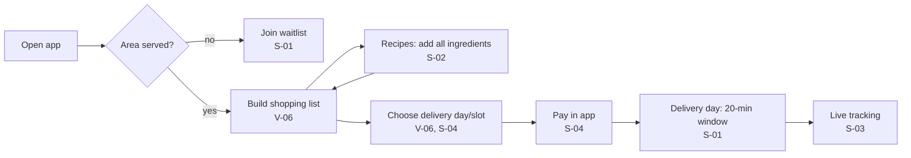
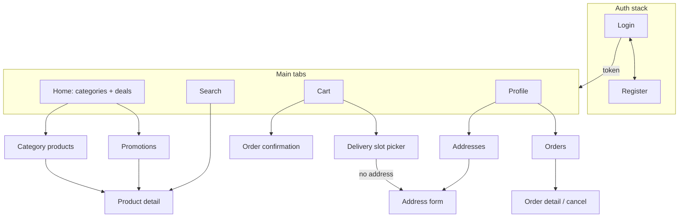
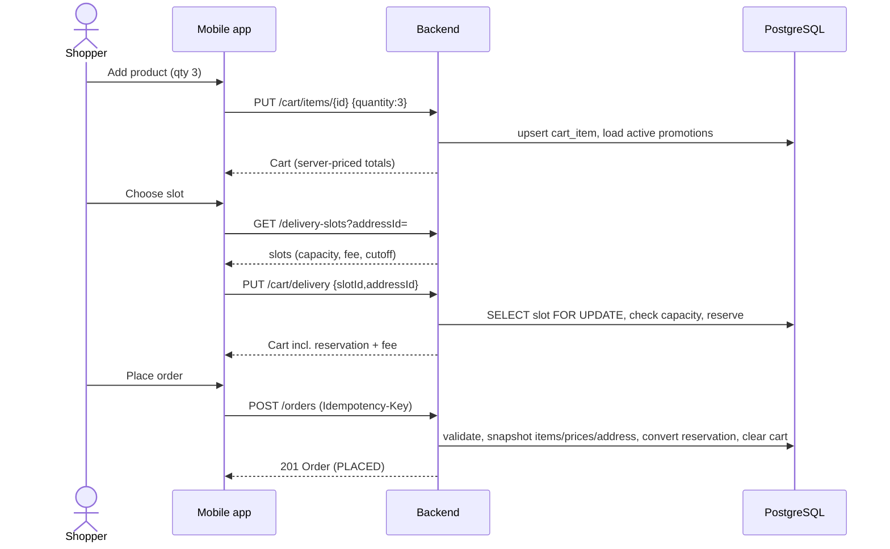
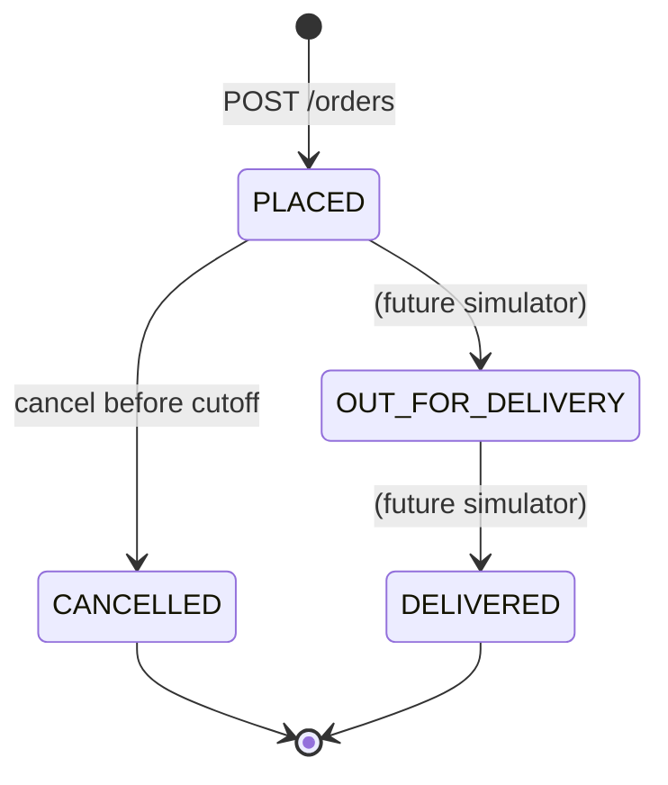

# User flows

The first diagram is our reading of the **reported** high-level Picnic flow
(V-06, S-01, S-04). The rest describe the **Dukkan** design. They are kept
separate on purpose.

## Reported flow (Picnic, high level, not verified on an artifact)

## Dukkan: navigation map

## Dukkan: checkout sequence

## Dukkan: order state machine

